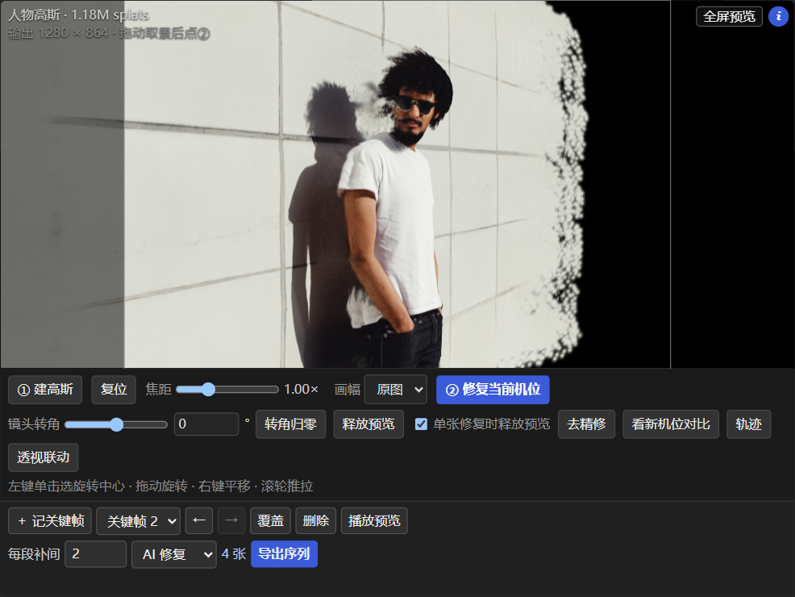
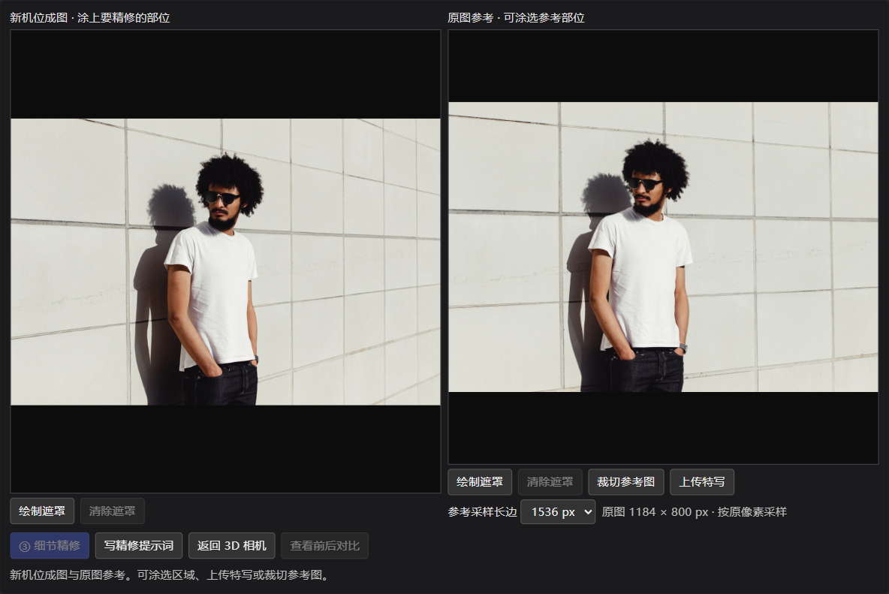

# ComfyUI SHARP Portrait

Interactive single-image portrait novel-view synthesis using Apple SHARP, Gaussian splats, Qwen-Image 2.1 Turbo INT8 and Splat Repair. [中文完整指南](README.md)

Build a splat from one photo, move the camera visually, then generate a repaired view. Masked refinement supports a second reference, uploaded close-ups, freehand masks, cropping and independent reference resolution. Additional controls include click-to-pivot, camera roll, full-screen preview, dolly zoom, keyframes and camera trajectory export.

## Results

The original photograph, the SHARP render at a changed camera pose, and the repaired image. The middle and right images use the same camera. Their native output size is 768 × 512. Click an image for full size.

| Input photograph | SHARP at the new viewpoint | Qwen + Splat Repair |
| :---: | :---: | :---: |
|  |  |  |

Unobserved details are inferred. Facial structure, clothing and background can change.

## Workflow interface

The horizontal workspace provides the input, 3D camera, view comparison, reference refinement and final comparison, with sampling and model controls below.

### Camera and trajectory

### Masked reference refinement

Paint the target on the left and upload, crop or mask the reference on the right. Reference sampling resolution is adjustable in the same panel.

Screenshots show the actual interface populated with saved test results. [Media provenance and settings](docs/MEDIA.md).

## Install

Tested on Windows, Python 3.12, ComfyUI 0.42.5, frontend 1.55.18 and an RTX 5070 Ti Laptop GPU with 12 GB VRAM. Other platforms are unverified.

~~~shell
git clone https://github.com/lueluelue12138/ComfyUI-SHARP-Portrait.git custom_nodes/ComfyUI-SHARP-Portrait
python -m pip install -r custom_nodes/ComfyUI-SHARP-Portrait/requirements.txt
~~~

Use the ComfyUI Python executable. Move an older portrait_sharp_repair installation outside custom_nodes to avoid duplicate node IDs.

Install [Apple SHARP](https://github.com/apple-aiml-research/ml-sharp) in a separate CUDA environment, or reuse [sharp-gui](https://github.com/lueluelue12138/sharp-gui). Set the environment variable PORTRAIT_SHARP_PYTHON to its Python executable, then fully restart the launcher. If sharp is installed in ComfyUI's environment, the current executable can be used automatically.

Download exact model filenames from the [model table](README.md#模型). View synthesis needs the SHARP checkpoint, Qwen Turbo diffusion model, vision text encoder, VAE and Splat Repair human LoRA. Detail workflows additionally reference the Goohai consistency LoRA, obtained through its author's channels.

## Workflow

Download [SHARP_Portrait_Mask_Detail.json](workflows/SHARP_Portrait_Mask_Detail.json) and drop it onto ComfyUI. Install this pack plus [Goohaitools-comfyui](https://github.com/goohai/Goohaitools-comfyui), [rgthree-comfy](https://github.com/rgthree/rgthree-comfy) and [ComfyUI-Easy-Use](https://github.com/yolain/ComfyUI-Easy-Use). The mask detail workflow includes the full camera, repair, refinement and trajectory sequence.

Drop a workflow JSON onto ComfyUI. Upload a photo, build its splat, move the camera, then repair the current view. Left-click selects the orbit pivot, left-drag orbits, right-drag pans and the wheel changes distance. Roll straightens the frame.

For refinement, paint the target on the left and upload or crop a reference on the right. Target crop dimensions set the output canvas. The reference is sampled independently with preserved aspect ratio. Default detail strength is 0.44. Reference detail sampling supports a maximum long edge of 2048. Main output and original-reference long edges support up to 2560.

Manual preview release destroys WebGL resources and terminates its worker while retaining the pose, pivot and keyframes. Published workflows enable release after single-frame capture by default. Restore reloads the same PLY. Sequence export retains the renderer for successive captures.

Record keyframes and set in-between samples to export raw splat renders or individually repaired views. Files and transforms.json are saved under output/人物换视角/相机轨迹. Image save nodes offer a local folder picker. Identical SHARP inputs reuse a temporary PLY. Different inputs accumulate files during a session, with ComfyUI responsible for startup and normal shutdown temp cleanup.

The setup checker lists missing node types and model selections without executing a graph.

~~~shell
python custom_nodes/ComfyUI-SHARP-Portrait/tools/check_setup.py
~~~

## Limits and attribution

Unseen surfaces are inferred. Identity and geometry can drift at large camera offsets. Reconstructed 3D quality and long high-resolution sequence memory behavior have not been systematically benchmarked. Keyframe interpolation interpolates cameras, and output images are generated separately.

The implementation adapts aaljman's GaussianViewer and prefill code, integrates SHARP and Splat Repair and follows the user's optimized Goohai Qwen detail workflow. [Third-party notices](THIRD_PARTY_NOTICES.md) describe sources and adapted components. The code is MIT-licensed. Model weights and dependencies retain their original terms.

[Upstream comparison examples](https://github.com/aaljman/splat-repair-lora#readme) belong to Splat Repair's authors. The README also includes this project’s own recorded test results. See [media notes](docs/MEDIA.md) for provenance and settings.
