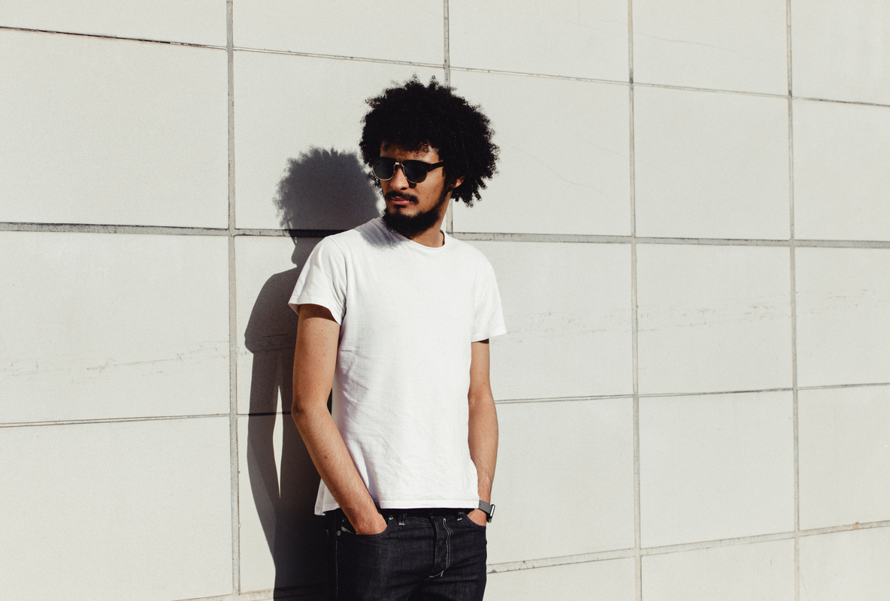
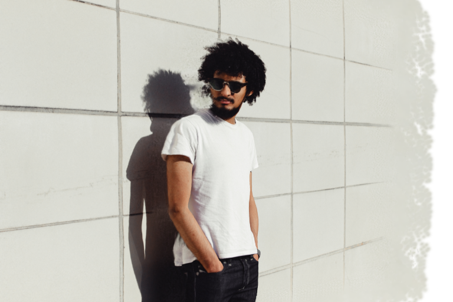
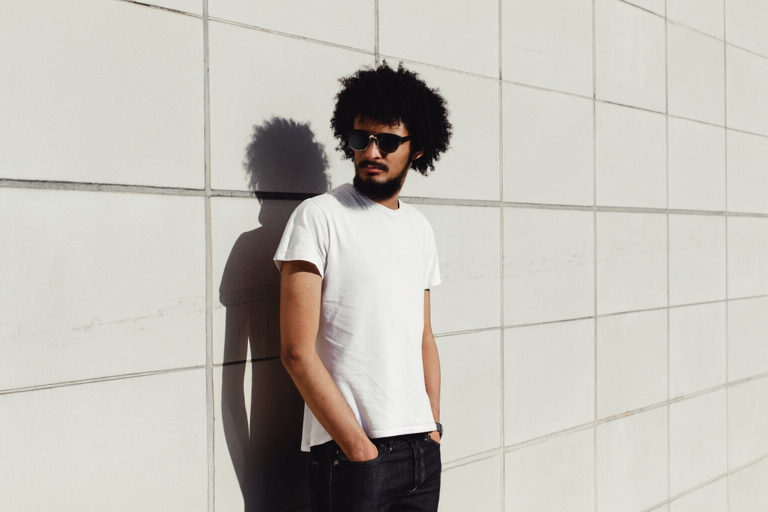
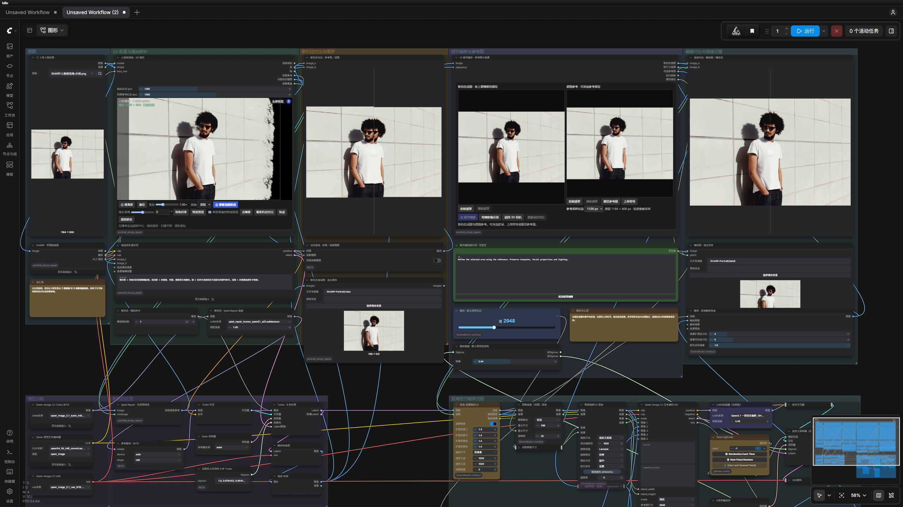
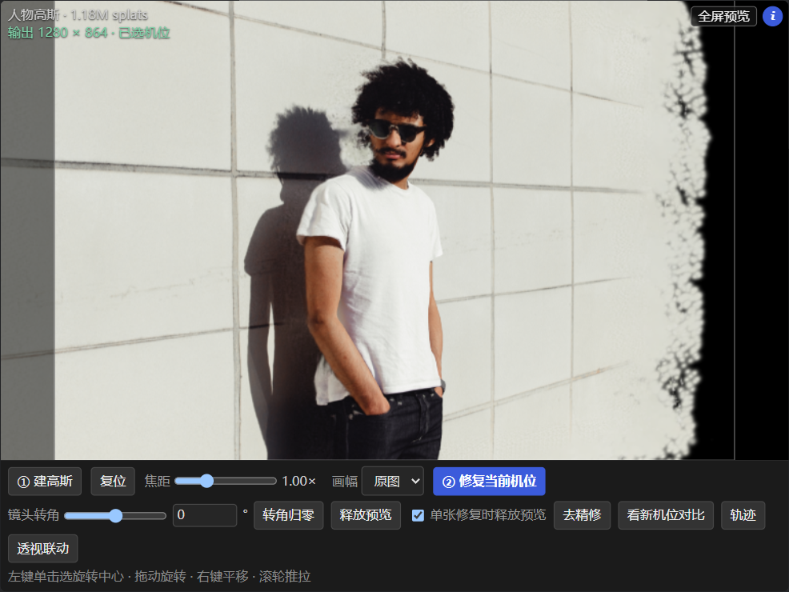
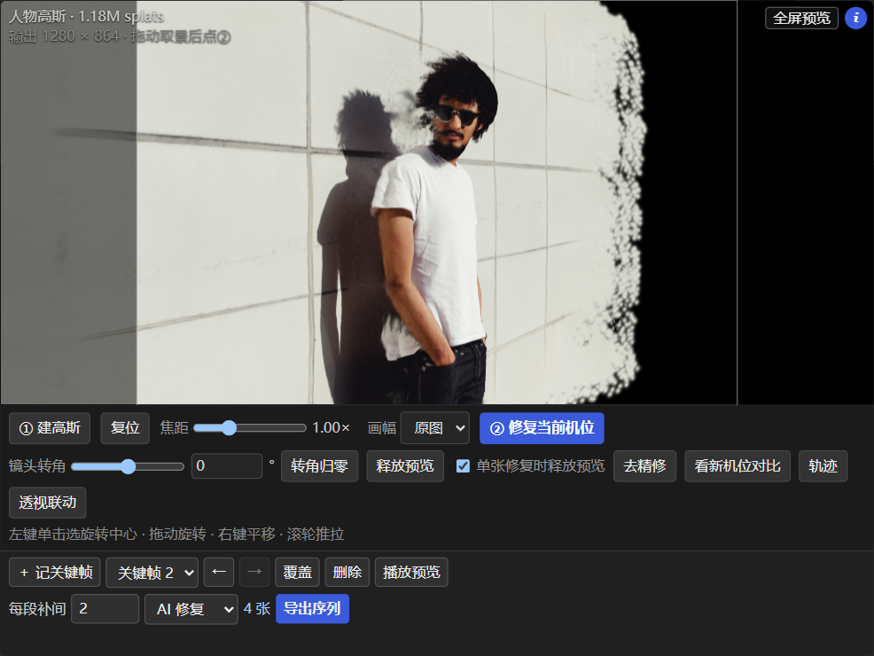
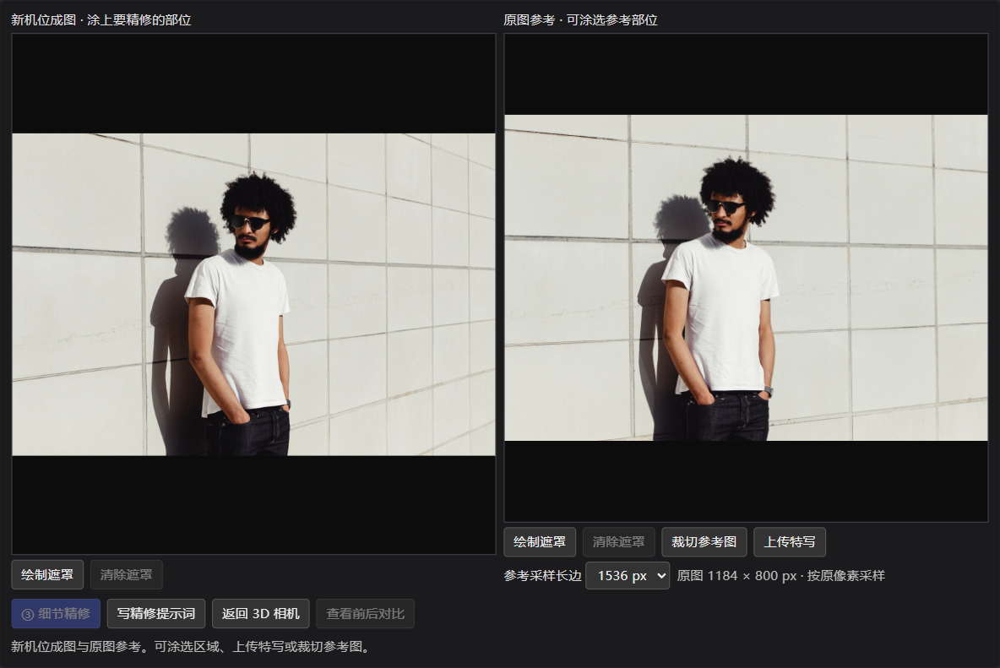

# ComfyUI SHARP Portrait · 单图人物换视角

**Interactive single-photo portrait novel-view synthesis with Apple SHARP, Gaussian splatting, Qwen-Image 2.1 Turbo INT8 and Splat Repair.**

[English guide](README.en.md) · [工作流](workflows) · [来源与致谢](THIRD_PARTY_NOTICES.md) · [实际效果](#实际效果)

从一张人物照片生成高斯，在 3D 相机里拖动取景，确认后生成修复图，再根据原图或特写精修细节。各阶段可以独立操作。最新精修版采用横向大操作区，自由遮罩、参考上传、裁切和采样参数放在操作面板。

## 实际效果

同一张人物照片，先在 3D 相机中换角度，再用 Qwen + Splat Repair 修复。中间和右侧对应同一机位，原始输出为 768 × 512，点击图片可以查看原图。

| 输入照片 | 新机位高斯粗图 | 新机位修复成图 |
| :---: | :---: | :---: |
|  |  |  |

该示例展示可见区域和边缘缺损的补全。原图没有提供的信息由模型推测，脸型、衣服和背景仍可能变化。

## 工作流操作界面

横向操作区依次为原图、3D 取景、新机位对比、遮罩精修和精修前后对比。下方是采样与模型参数。点击截图查看大图。

### 拖动取景与轨迹

单击人物选旋转中心，拖动选角度，可扶正镜头、全屏查看，并在修复前释放预览资源。

记录多个关键帧、设置补间数量后，可逐帧导出高斯粗图或 AI 修复图。

### 双图参考与局部精修

左侧使用新机位成图，右侧保留原图细节参考，也可上传特写、裁切和涂选参考。参考采样长边在面板内独立设置。

截图使用本项目实际界面，并载入同一组已保存的测试结果。示例文件和取景参数见 [媒体说明](docs/MEDIA.md)。

## 功能

- 可视化相机，左键单击选旋转中心、拖动旋转，右键平移，滚轮推拉。
- 镜头转角扶正、画幅选择、全屏预览、主体透视联动（dolly zoom）。
- 高斯粗图与原图双图参考修复，可通过提示词引导空洞补全。
- 输出长边最高 2560，换视角的原图参考长边可独立设到 2560。
- 自由遮罩、参考特写上传和裁切，独立参考采样上限最高 2048。目标画布跟随目标裁块宽高，参考图单独等比例处理。
- 相机关键帧、平滑补间、逐帧导出粗图或 AI 修复图，同时保存相机参数 transforms.json。
- 预览释放与恢复，保留机位、旋转中心和关键帧。单张修复可取景后释放预览，再开始生图。
- 关键步骤图像对比和可选择本机目录的保存节点。

单图未见区域由模型推测，跨角度一致性及后续高斯重建质量需按素材验证。轨迹补间计算相机位置，每个新角度独立生成图片，尚未集成时间一致性视频模型。

## 安装

已验证开发环境为 Windows、Python 3.12、NVIDIA CUDA、ComfyUI 0.42.5、前端 1.55.18，使用 12 GB 显存笔记本。其他平台尚未验证。高分辨率与大参考图会增加内存、显存及时间开销。

在 ComfyUI 根目录执行，python 应替换成 ComfyUI 实际使用的 Python。

~~~shell
git clone https://github.com/lueluelue12138/ComfyUI-SHARP-Portrait.git custom_nodes/ComfyUI-SHARP-Portrait
python -m pip install -r custom_nodes/ComfyUI-SHARP-Portrait/requirements.txt
~~~

若已有旧版 portrait_sharp_repair，将旧包移出 custom_nodes，同一套节点 ID 只加载一次。

### SHARP 环境

SHARP 在独立子进程里建模，完成后退出并释放其显存。已有 [sharp-gui](https://github.com/lueluelue12138/sharp-gui) 环境可以复用其 venv，或按 [Apple SHARP 安装说明](https://github.com/apple-aiml-research/ml-sharp#readme) 创建独立 CUDA 环境。

设置 PORTRAIT_SHARP_PYTHON 为安装了 sharp 模块的 Python 完整路径。Windows PowerShell 示例，路径请替换。

~~~powershell
$env:PORTRAIT_SHARP_PYTHON = "D:/ML/sharp-env/Scripts/python.exe"
[Environment]::SetEnvironmentVariable("PORTRAIT_SHARP_PYTHON", $env:PORTRAIT_SHARP_PYTHON, "User")
~~~

完全退出并重新打开 ComfyUI 启动器，使其继承变量。若 ComfyUI 当前 Python 已安装 sharp，本包也可自动使用当前环境。Linux 可通过 export 设置同名变量，平台本身尚未验证。

### 模型

| 文件名 | ComfyUI 目录 | 来源 |
| --- | --- | --- |
| sharp_2572gikvuh.pt | models/checkpoints | [Apple 官方](https://ml-site.cdn-apple.com/models/sharp/sharp_2572gikvuh.pt) |
| qwen_image_2.1_turbo_int8_convrot.safetensors | models/diffusion_models | [Comfy-Org](https://huggingface.co/Comfy-Org/Qwen-Image-2.1/tree/main/diffusion_models) |
| qwen3vl_8b_int8_convrot.safetensors | models/text_encoders | [Comfy-Org](https://huggingface.co/Comfy-Org/Qwen-Image-2.1/tree/main/text_encoders) |
| qwen_image_2.1_vae_bf16.safetensors | models/vae | [Comfy-Org](https://huggingface.co/Comfy-Org/Qwen-Image-2.1/tree/main/vae) |
| splat_repair_human_qwen21_e23.safetensors | models/loras | [aaljman / Splat Repair](https://github.com/aaljman/splat-repair-lora) |
| Qwen2.1 一致性无偏移_GH_V1.0.safetensors | models/loras，仅精修需要 | [孤海及其作者发布渠道](https://github.com/goohai/Goohaitools-comfyui) |

模型从各自来源下载并遵循原作者条款。孤海精修 LoRA 的下载渠道可能随作者更新，请通过作者渠道获取。该 LoRA 用于可选的局部精修分支。

## 工作流

下载 [SHARP_Portrait_Mask_Detail.json](workflows/SHARP_Portrait_Mask_Detail.json)，拖入 ComfyUI，即可使用建高斯、换视角、修复、遮罩精修和轨迹导出。

需要安装本节点包，以及 [Goohaitools-comfyui](https://github.com/goohai/Goohaitools-comfyui)、[rgthree-comfy](https://github.com/rgthree/rgthree-comfy) 和 [ComfyUI-Easy-Use](https://github.com/yolain/ComfyUI-Easy-Use)。第三方包可通过 Manager 安装，模型见上表。

重启后若出现红节点，检查节点包和 ComfyUI 版本。可在 ComfyUI 运行时执行只读检查，查看缺失节点和已注册模型。

~~~shell
python custom_nodes/ComfyUI-SHARP-Portrait/tools/check_setup.py
~~~

## 操作

1. 上传人物照片，点「① 建高斯」。
2. 在 3D 预览中单击主体选旋转中心，拖动调整角度。用「镜头转角」扶正。
3. 设置输出与参考长边、修补提示词，点「② 修复当前机位」。
4. 精修时左图涂抹需要增强的区域，右图上传特写或裁切原图，也可涂选参考部位。面板显示原始选区与实际采样像素。
5. 点细节精修，查看前后对比。「精修幅度」默认 0.44，增大会提高重绘幅度和结构变化。
6. 导出序列时打开「轨迹」，添加关键帧，设置每段补间和输出模式。

发布版默认勾选「单张修复时释放预览」。取景图保存后释放 WebGL 和排序 Worker，再提交生图。点「恢复预览」可继续使用同一 PLY。轨迹导出需要逐帧取景，期间保留预览资源。

## 保存和限制

基础图及精修图默认写入 output/SHARP-Portrait，保存节点可选择本机绝对路径。轨迹写入 output/人物换视角/相机轨迹/序列编号，包含 PNG 和 transforms.json。相机参数对应粗图取景，AI 修复可能改变局部几何，重建质量尚未系统验证。

相同图像、焦距及权重复用临时 PLY。换图或焦距会产生新文件，在本次运行期间累积，由 ComfyUI 临时目录维护在启动和正常退出时清理。轨迹逐帧串行提交，模型由 ComfyUI 管理，Qwen 使用 auto + INT8 参考缓存。长序列高分辨率显存峰值尚未系统压测。

大角度绕到背面时，缺失的脸部、发型、服饰和背景由模型推测。精修参考越清晰、越接近同一人物及目标角度，越容易保留细节。目录选择器供本机使用，交互取景及序列导出需要打开前端。

## 来源和示例

本项目改编了 aaljman 的 GaussianViewer 与空洞预填充，采用 Apple SHARP 及 Splat Repair LoRA，并整合用户提供的孤海 Qwen 2.1 Turbo 调优流程。改编范围、依赖和许可证入口见 [THIRD_PARTY_NOTICES.md](THIRD_PARTY_NOTICES.md)。

本页效果图来自本项目的实际测试。另可参考 [Splat Repair 上游对比示例](https://github.com/aaljman/splat-repair-lora#readme)，其中结果归原作者。演示输入与生成结果的说明见 [媒体说明](docs/MEDIA.md)。

代码采用 MIT，保留改编部分署名。Apple SHARP、Qwen、LoRA 与依赖分别适用原始代码和模型条款。

Search terms · ComfyUI SHARP portrait, Gaussian splatting, single image novel view synthesis, Qwen Image 2.1 Turbo INT8, Splat Repair, reference image detail refinement, orbit camera, dolly zoom, camera trajectory, 人物换视角, 单图人物重建, 高斯修复, 双图参考, 细节精修.
